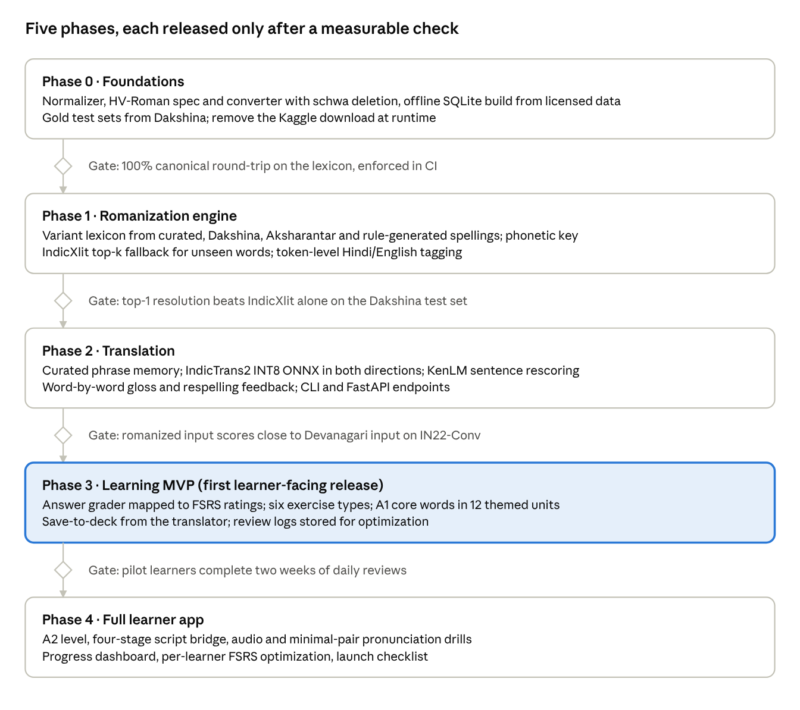

# HinglishVinglish: Analysis & Implementation Plan

Oct 26, 2026 · @Ayan

## Summary

The premise works, but only if the app treats Devanagari as the hidden source of truth and romanization as a presentation layer with one taught spelling plus a set of accepted variants. Today the MVP does exact sentence lookup on raw text with ITRANS, which will miss almost every real input.

Headline recommendations:

1. **Pivot through Devanagari.** Every Hindi word is stored once in Devanagari. Romanized forms (canonical and variants) are keys that resolve to it, never the stored truth.
2. **Define a house romanization, "HV-Roman", not raw ITRANS.** All-lowercase ASCII, Hindi-style schwa deletion (raam, not raama), doubled vowels for long sounds, with an optional diacritic learner view. ITRANS stays internal as a lossless pivot.
3. **Build a variant lexicon from Dakshina and Aksharantar.** Map attested spellings (bahut, bohot, bhot) to one Devanagari entry, with a phonetic-key fallback for unseen spellings.
4. **Replace exact sentence matching with a layered translator:** exact phrase memory, then a neural model (IndicTrans2) for anything else, with word-by-word gloss for learners.
5. **Build the learning app on the same lexicon:** spaced repetition (FSRS), typing drills that accept any listed variant but teach the canonical one, and script-reveal exercises that move learners toward Devanagari.
6. **Check licensing before shipping.** Several key corpora are research-only or non-commercial.

### Decisions (Oct 26, 2026)

| Question | Decision | What it changes |
| --- | --- | --- |
| Commercial or not? | Functionality first; commercial later | Any source may be used in development, but every row is license-tagged so a commercial build can exclude non-commercial data |
| Delivery surface | Web and mobile app | One Expo (React Native) codebase for iOS, Android and web; FastAPI backend |
| Final-vowel convention | kya / achha | Word-final आ, ई, ऊ are written a, i, u; medial ones aa, ee, oo |
| Audio | Start with whatever works, upgrade later | Pre-generated TTS (Indic Parler-TTS) first; native recordings for core words later |
| Scope | Hindi first; eventually all non-Latin-script languages | Engine is built around a pluggable LanguagePack so other scripts slot in |

### How this plan is organized

This tab is the overview. The detail a developer needs lives in five tabs:

- Linguistics & HV-Roman spec — the normative romanization spec, phonology, normalization, phonetic key, grammar and ambiguity rules
- Learning science — the research behind every learning feature, the learner model and the curriculum
- Technical architecture — stack, system diagram, interfaces, API, budgets and multi-script design
- Development plan — ticket-level backlog with acceptance criteria and the testing strategy
- Data & licensing — provenance and license of every source, and the build-time license gate

## Analysis of the current MVP

The MVP's architecture (CLI, translator, dataset manager) is a sensible start, but its two core design choices, raw ITRANS and exact sentence matching, work against the premise. A learner typing "bahut accha" or "hello" will almost always get "No translation found."

| Issue in README / MVP | Why it matters | Fix in this plan |
| --- | --- | --- |
| ITRANS is case-sensitive (A, I, U, T, D, N, Sh are distinct letters) | English speakers type lowercase; "Tota" and "tota" mean different consonants. It is not "easy for English speakers" in practice. | Learner-facing HV-Roman is all lowercase; ITRANS kept only as an internal lossless pivot |
| README examples don't match ITRANS output | धन्यवाद in ITRANS is dhanyavAda, not dhanyavaad. The doc already mixes two schemes. | One documented canonical scheme, with generated examples tested in CI |
| No schwa deletion | Script-to-Roman tools keep the inherent final "a" (shubha, raama), but Hindi speakers say shubh, raam. Learners will mispronounce. | Schwa-deletion step in the Devanagari-to-Roman converter |
| Pronunciation table errors | The inherent vowel in ka/na is the "u" in "but", not the "o" in "not". | Rewrite guide with audio and IPA |
| Exact sentence matching only | The dataset is sentence pairs; single words and novel sentences never match. | Layered translator: phrase memory, then neural MT, then word gloss |
| Romanized input must equal the dataset's exact transliteration | Any spelling variant misses. Romanized Hindi has no conventional spelling. | Variant lexicon + phonetic key resolve input to Devanagari first |
| No text normalization | Case, punctuation, nukta (ज़ vs ज), anusvara vs half-nasal all break lookups. | Unicode NFC + Hindi-specific normalizer on both sides |
| Kaggle credentials needed at runtime | High setup friction; provenance and license of the Kaggle file are not stated on its page. | Offline build step produces a versioned SQLite artifact from licensed sources |
| "Hinglish" in the name, but no code-mixing | Real Hinglish mixes English words into Hindi sentences. | Token-level language ID so English words pass through untouched |

## Research findings

The hard problem is not translation, which mature open models already do well, but romanization: there is no conventional Latin spelling for most Hindi words, so spelling varies widely ([Benton et al., Google, 2025](https://arxiv.org/abs/2504.21540)). Every resource below exists to tame that.

**Spelling variation is the core problem.** The same word appears as bahut, bohot, boht and bhot ([dhvani](https://pypi.org/project/dhvani/)). Variation comes from vowel omission, consonant simplification, dropped aspiration and non-standard spellings ([Modeling Romanized Hindi, 2025](https://arxiv.org/pdf/2511.22769); [Parikh & Solorio, 2021](https://aclanthology.org/2021.calcs-1.15)). Prior work normalizes with context clustering, phonetics or IPA as a bridge.

**Schwa deletion decides how a word should be spelled and said.** Hindi drops the inherent vowel at word ends and in some medial positions, and getting it wrong is the main error in Hindi grapheme-to-phoneme conversion ([Wikipedia: Hindustani orthography](https://en.wikipedia.org/wiki/Hindustani_orthography)). A statistical classifier outperforms rule-based approaches, with code and data released ([Arora et al., ACL 2020](https://aclanthology.org/2020.acl-main.696); [repo](https://github.com/aryamanarora/schwa-deletion)).

### Resources

| Resource | What it gives HinglishVinglish | License / caveat |
| --- | --- | --- |
| [Dakshina](https://arxiv.org/pdf/2007.01176) (Google) | Hindi romanization lexicon: 25,000 train + 5,000 dev/test Devanagari word types, \~1.8 attested romanizations each, plus 10,000 hand-romanized sentences | CC BY-SA 4.0 (attribution + share-alike) |
| [Aksharantar](https://arxiv.org/abs/2205.03018v2) (AI4Bharat) | 26M transliteration pairs across 21 languages; the largest variant source | CC-BY (manual data) / CC0 (mined data) |
| [IndicXlit](https://github.com/AI4Bharat/IndicXlit) | Roman-to-Devanagari model returning ranked candidates; \~11M params; a [CTranslate2 build](https://huggingface.co/Singla0009/all-indic-transliteration) avoids the Fairseq install and adds a reverse model | Open-source |
| [IndicTrans2](https://github.com/AI4Bharat/IndicTrans2) | Open English↔Hindi NMT across 22 languages; distilled 200M models; [INT8 ONNX builds](https://huggingface.co/remiai3/TRANSLATION_MODELS) run offline in \~300 MB | Checkpoints MIT |
| [indic\_transliteration](https://github.com/indic-transliteration/indic_transliteration_py) | Rule-based Devanagari↔ITRANS/IAST/HK; OPTITRANS has a "lay Indian" output (kRShNa → krishna) | Open-source; already a dependency |
| [IIT Bombay corpus](https://arxiv.org/abs/1710.02855v2) | 1.49M English–Hindi sentence pairs plus Hindi–English WordNet dictionary entries | Non-commercial research only |
| [dhvani](https://pypi.org/project/dhvani/) | Off-the-shelf Hinglish phonetic normalizer via IPA | Useful as a baseline to compare against |
| [py-fsrs](https://github.com/open-spaced-repetition/py-fsrs) | Modern spaced-repetition scheduler (difficulty, stability, retrievability) with a parameter optimizer | MIT |

**Romanization schemes considered.** ITRANS, Harvard-Kyoto, IAST, SLP1 and Velthuis are all supported by indic\_transliteration. They are lossless but designed for Sanskrit: they keep every schwa and rely on case or diacritics. None matches how Hindi speakers actually type, which is why a house scheme is needed.

## System design: standardized romanization and bidirectional translation

Every Hindi word lives once, in Devanagari; each has exactly one canonical HV-Roman spelling the app teaches and any number of accepted variants it understands. Translation always happens Devanagari↔English, so the romanization layer and the translation layer can improve independently.

### 1. The canonical scheme: HV-Roman

HV-Roman is lowercase ASCII, matches how Hindi speakers already type, and is generated by rule from Devanagari, so it is consistent by construction. Where it is lossy (त vs ट), the lexicon disambiguates, and a learner "precise view" shows IAST diacritics (ṭ, ā).

| Sound / letter | HV-Roman | Example | Accepted variants |
| --- | --- | --- | --- |
| अ short a | a (dropped where Hindi deletes schwa) | राम raam | ram |
| आ long ā | aa medially, a word-finally | राजा raaja, क्या kya | a, aa everywhere |
| इ / ई | i / ee | दिल dil, ठीक theek | ii, i |
| उ / ऊ | u / oo | तुम tum, दूध doodh | uu, u |
| ए / ऐ | e / ai | है hai | he, h |
| ओ / औ | o / au | और aur | or |
| aspirates | kh gh chh jh th dh ph bh | अच्छा achha | accha, acha |
| च / छ | ch / chh | चाय chaay | chai, chay |
| श ष / स | sh / s | शुभ shubh | subh |
| व | v | वाला vaala | wala, vala |
| nukta ज़ फ़ ड़ | z f r | ज़रूर zaroor | jaroor, zarur |
| ं ँ nasal | n (m before p/b/m) | नहीं nahin | nahi, nai |

The schwa rule is the single most important step: शुभ is taught as shubh, not ITRANS shubha. Rule-based schwa deletion handles most words; the Arora et al. classifier handles the rest, and the lexicon can override any word by hand.

### 2. The variant lexicon

Each entry links a Devanagari word to its canonical spelling, English glosses and a ranked list of accepted variants. Variants come from four sources, in order of trust: hand-curated overrides, Dakshina's human-attested romanizations, Aksharantar's mined pairs, and rule-generated alternations (aa↔a, ee↔i, oo↔u, w↔v, dropped aspiration h, z↔j, f↔ph, ai↔e, final n dropped). Each variant stores a frequency score so common spellings rank first.

For spellings never seen, a phonetic key collapses what romanizers vary on (vowel length, aspiration h, doubled letters, w/v, z/j). bahut, bohot and bhot share a key; candidates sharing it are reranked by weighted edit distance and word frequency.

### 3. Romanized Hindi → English

1. **Normalize and tokenize:** lowercase, strip punctuation, keep numerals.
2. **Tag each token Hindi or English** with an English wordlist plus a small character n-gram classifier, so code-mixed "mera phone kharab hai" keeps "phone".
3. **Resolve each Hindi token to Devanagari candidates:** canonical match, then variant match, then phonetic key, then IndicXlit top-k as a fallback.
4. **Pick the best sentence** by rescoring candidate combinations with a Hindi n-gram language model (KenLM on Hindi Wikipedia), so "ki" resolves to कि or की by context.
5. **Translate** the Devanagari sentence: exact phrase memory first, IndicTrans2 hi→en otherwise.
6. **Return** English, Devanagari, the canonical HV-Roman respelling ("you wrote bohot, we teach bahut") and a word-by-word gloss.

### 4. English → Romanized Hindi

1. **Phrase memory** for curated, learner-friendly phrases (greetings, survival phrases), which beat MT on register.
2. **IndicTrans2 en→hi** for everything else, producing Devanagari.
3. **Devanagari → HV-Roman**: lexicon lookup for each word's canonical spelling; the rule converter with schwa deletion for unknown words.
4. **Gloss** each Hindi word with its lexicon meaning, plus a formality note (tum / aap / tu) where relevant.

**Invariant tested in CI:** for every lexicon word, resolving its canonical HV-Roman spelling returns the same Devanagari word. This is the guarantee that the standard is truly bidirectional.

## Language learning application

The learning app reuses the translation engine as its grader: a typed answer is correct when it resolves to the target Devanagari word, so learners are never failed for a valid variant spelling, but are always shown the canonical one.

### Exercise types

| Exercise | Prompt → answer | What it trains |
| --- | --- | --- |
| Recognize | HV-Roman (+ audio) → pick or type English | Comprehension |
| Produce | English → type Hindi in any accepted spelling | Recall and spelling |
| Listen | Audio only → type Hindi | Ear for schwa, aspiration, retroflex sounds |
| Read script | Devanagari → type HV-Roman or English | Script literacy |
| Cloze | Sentence with a gap → fill the word | Grammar in context (postpositions, gender agreement) |
| Translate | Short sentence either way, graded by the pipeline | Putting it together |

### Automatic grading mapped to spaced repetition

Each word is an FSRS card, and grades come from the resolver rather than self-rating, which removes the honesty problem of flashcard apps.

- Exact canonical spelling, fast answer → **Easy**
- Accepted variant (bohot for bahut) → **Good**, plus a gentle "standard spelling: bahut" note
- Resolves to the right word only via phonetic key or a near-miss edit → **Hard**, with a diff of the spelling
- Resolves to a different word, or nothing → **Again**

Review logs feed the py-fsrs optimizer, so intervals adapt to each learner after a few hundred reviews.

### Curriculum

1. **Core vocabulary first:** the 1,000 most frequent Hindi words (ranked from a Hindi corpus), grouped into themed units: greetings, numbers, family, food, travel, time, everyday verbs.
2. **Phrases before grammar:** survival phrases from the curated phrase memory, then sentence patterns that teach hai/hoon/ho, postpositions (ka/ki/ke, mein, par) and verb gender.
3. **Script bridge in four stages:** Roman only, Roman with Devanagari beneath, Devanagari with Roman on tap, Devanagari only. Learners advance per letter group as their reading accuracy passes a threshold.
4. **Pronunciation focus:** minimal pairs for dental vs retroflex (त/ट) and plain vs aspirated (क/ख), which HV-Roman's lowercase form hides.

### Translator as a study tool

Any sentence translated in the app can be saved to a personal deck with one action. The output shows the word-by-word gloss and the respelling note, so the translator teaches instead of only answering.

## Data model and project structure

A single SQLite file, built offline and versioned, holds the lexicon, variants, phrase memory and learner state; models load lazily so the app starts without them.

```sql
-- Lexicon: one row per Hindi word (Devanagari is the key)
CREATE TABLE lemma (
  id INTEGER PRIMARY KEY,
  deva TEXT UNIQUE NOT NULL,        -- नमस्ते
  canonical TEXT NOT NULL,          -- HV-Roman: namaste
  precise TEXT,                     -- IAST: namaste
  pos TEXT, gender TEXT,
  freq_rank INTEGER,
  override BOOLEAN DEFAULT 0        -- hand-curated spelling wins
);
CREATE TABLE gloss (
  lemma_id INTEGER REFERENCES lemma(id),
  english TEXT NOT NULL, sense_rank INTEGER
);
CREATE TABLE variant (
  spelling TEXT NOT NULL,           -- bohot
  lemma_id INTEGER REFERENCES lemma(id),
  source TEXT,                      -- curated | dakshina | aksharantar | rule
  score REAL,
  PRIMARY KEY (spelling, lemma_id)
);
CREATE TABLE phonetic_key (key TEXT, lemma_id INTEGER);
CREATE TABLE phrase (
  id INTEGER PRIMARY KEY,
  english TEXT, deva TEXT, canonical TEXT,
  register TEXT, unit TEXT, source TEXT
);
-- Learner state
CREATE TABLE card (
  id INTEGER PRIMARY KEY, user_id INTEGER,
  lemma_id INTEGER, phrase_id INTEGER,
  exercise TEXT, fsrs_state TEXT, due TIMESTAMP
);
CREATE TABLE review_log (
  card_id INTEGER, rating INTEGER, answer TEXT,
  resolved_as TEXT, latency_ms INTEGER, reviewed_at TIMESTAMP
);
```

```text
hinglishvinglish/
├── hv/
│   ├── romanize/
│   │   ├── scheme.py        # HV-Roman spec: Devanagari -> canonical
│   │   ├── schwa.py         # rules + classifier
│   │   ├── normalize.py     # NFC, nukta, nasal, case
│   │   └── phonetic_key.py
│   ├── resolve/
│   │   ├── langid.py        # token Hindi/English
│   │   ├── candidates.py    # lexicon, key, IndicXlit
│   │   └── rerank.py        # KenLM sentence choice
│   ├── translate/
│   │   ├── memory.py        # phrase memory
│   │   ├── nmt.py           # IndicTrans2 (ONNX)
│   │   └── gloss.py
│   ├── learn/
│   │   ├── grader.py        # answer -> FSRS rating
│   │   ├── scheduler.py     # py-fsrs wrapper
│   │   └── curriculum.py
│   └── store.py             # SQLite access
├── build/                   # offline data pipeline
│   ├── ingest_dakshina.py
│   ├── ingest_aksharantar.py
│   ├── build_lexicon.py
│   └── build_phrases.py
├── api/                     # FastAPI service
├── web/                     # learner front end (PWA)
├── cli.py                   # successor to app.py
└── tests/                   # round-trip, gold sets
```

This layout is a sketch; the monorepo layout in Development plan supersedes it.

## Phased roadmap

Build the romanization engine before touching translation or learning features, because both depend on it. Each phase ships behind a measurable gate, and Phase 3 is the first release learners see.



Phases 0–2 can run with one developer; Phase 4 needs front-end and audio work. With one engine developer and one app developer, the estimate is roughly 25–27 weeks from Phase 0 to public launch; ticket-level detail is in the Development plan tab.

## Evaluation, risks and decisions

The system is only as trustworthy as its gold sets, so evaluation is built in Phase 1, before any model work. Targets below are proposed starting points to tune once baselines are measured.

### How it will be measured

| Check | Data | Proposed bar |
| --- | --- | --- |
| Canonical round-trip (HV-Roman → Devanagari → HV-Roman) | Every lexicon entry | 100%, enforced in CI |
| Variant resolution, top-1 Devanagari | Dakshina Hindi dev/test romanizations | Beat IndicXlit alone on the same set |
| Sentence resolution | Dakshina's 10,000 hand-romanized sentences | Word accuracy tracked per release |
| Translation quality | IndicTrans2's IN22-Conv benchmark, plus a romanized copy of it | chrF++ within a few points of feeding Devanagari directly |
| Learner outcomes | Review logs | Retention at review near the FSRS target; day-7 return rate |

### Risks

| Risk | Mitigation |
| --- | --- |
| Licensing: the IIT Bombay corpus is non-commercial; the Kaggle file's source and license are not stated; Dakshina is CC BY-SA 4.0 (share-alike) | Keep a data-provenance table; ship only commercially clear data in any paid build; replace the Kaggle file in Phase 1 |
| Canonical spellings are contested (achha vs accha) | Pick by attested frequency, document every choice, accept all variants as correct |
| Lossy lowercase hides sounds (त/ट, द/ड) | Devanagari pivot preserves them; precise view and minimal-pair drills teach them |
| Ambiguous short words (ki = कि / की, hai / he) | Sentence-level language-model rescoring; show alternatives when confidence is low |
| Model size and setup (IndicTrans2, IndicXlit) | INT8 ONNX and CTranslate2 builds; run server-side for the web app |
| MT register mismatches for learners (formal vs casual) | Curated phrase memory takes precedence; register tags on phrases |

### Decisions

- [x] Commercial or non-commercial: functionality first, commercial later (see Decisions in the Summary).
- [x] Delivery surface: web and mobile app.
- [x] Final-vowel convention: kya / achha.
- [x] Audio source: TTS first, native recordings later.
- [x] Scope: Hindi first, built to extend to other non-Latin scripts.

## Sources

- [Benton et al. (Google), Improving Informally Romanized Language Identification](https://arxiv.org/abs/2504.21540)
- [Roark et al., The Dakshina Dataset (LREC 2020)](https://arxiv.org/pdf/2007.01176)
- [Madhani et al., Aksharantar and IndicXlit](https://arxiv.org/abs/2205.03018v2)
- [AI4Bharat IndicXlit repository](https://github.com/AI4Bharat/IndicXlit)
- [IndicXlit CTranslate2 build (Hugging Face)](https://huggingface.co/Singla0009/all-indic-transliteration)
- [AI4Bharat IndicTrans2 repository](https://github.com/AI4Bharat/IndicTrans2)
- [IndicTrans2 INT8 ONNX packages](https://huggingface.co/remiai3/TRANSLATION_MODELS)
- [Kunchukuttan et al., IIT Bombay English-Hindi Parallel Corpus](https://arxiv.org/abs/1710.02855v2)
- [Modeling Romanized Hindi and Bengali (2025)](https://arxiv.org/pdf/2511.22769)
- [Parikh & Solorio, Normalization and Back-Transliteration for Code-Switched Data](https://aclanthology.org/2021.calcs-1.15)
- [dhvani: phonetic normalization for Hinglish](https://pypi.org/project/dhvani/)
- [Arora et al., Supervised Grapheme-to-Phoneme Conversion of Orthographic Schwas](https://aclanthology.org/2020.acl-main.696)
- [Hindustani orthography (Wikipedia)](https://en.wikipedia.org/wiki/Hindustani_orthography)
- [indic\_transliteration (Python)](https://github.com/indic-transliteration/indic_transliteration_py)
- [py-fsrs](https://github.com/open-spaced-repetition/py-fsrs) and [FSRS algorithm](https://www.github.com/open-spaced-repetition/free-spaced-repetition-scheduler)
- [Kaggle English-Hindi dataset page](https://www.kaggle.com/datasets/preetviradiya/english-hindi-dataset)
- [Schwa deletion in Indo-Aryan languages (Wikipedia)](https://en.wikipedia.org/wiki/Schwa_deletion_in_Indo-Aryan_languages)
- [Narasimhan, Sproat & Kiraz, Schwa-deletion in Hindi TTS (2004)](https://forms.mpi.nl/node/48164)
- [Nisaba script processing library](https://www.github.com/google-research/nisaba)
- [Unicode list: Devanagari nukta composition exclusions](https://corp.unicode.org/pipermail/unicode/2025-April/011441.html)
- [Aksharantar dataset card (Hugging Face)](https://huggingface.co/datasets/ai4bharat/Aksharantar/blob/main/README.md)
- [IndicLID / Bhasha-Abhijnaanam](https://ai4bharat.iitm.ac.in/?p=1123)
- [ai4bharat-transliteration (PyPI)](https://pypi.org/project/ai4bharat-transliteration/)
- [IndicTransToolkit](https://github.com/VarunGumma/IndicTransToolkit)
- [Indic Parler-TTS](https://huggingface.co/ai4bharat/indic-parler-tts)
- [indictrans2-conv: note on male-perspective output](https://github.com/saurabhv749/indictrans2-conv)
- [wordfreq](https://pypi.org/project/wordfreq)
- [uroman](https://pypi.org/project/uroman)
- [Cepeda et al., Distributed practice meta-analysis (2006)](https://pubmed.ncbi.nlm.nih.gov/16719566/)
- [Roediger & Karpicke, Reflections on the testing effect (2018)](https://moodle2.units.it/pluginfile.php/572734/mod_resource/content/1/testing.pdf)
- [Kornell & Bjork interleaving, via Birnbaum et al. (2013)](https://www.springermedizin.de/article/10.3758/s13421-012-0272-7)
- [Brunmair & Richter, Interleaving meta-analysis (2019)](https://www.psychologie.uni-wuerzburg.de/fileadmin/06020400/2019/Brunmair_Richter_in_press__2019_META-ANALYSIS_OF_INTERLEAVED_LEARNING.pdf)
- [Nation, How large a vocabulary (2006)](https://www.wgtn.ac.nz/__data/assets/pdf_file/0018/1626120/2006-How-large-a-vocab.pdf)
- [Duolingo half-life regression](https://blog.duolingo.com/how-we-learn-how-you-learn)
- [Pruitt, Training English speakers on Hindi dental/retroflex (1993)](https://auditory.org/asamtgs/asa93ott/4pSP/4pSP13.html)
- [Earle et al., Overnight consolidation of non-native speech sounds (2025)](https://www.ncbi.nlm.nih.gov/pmc/articles/PMC11740156/)
- [FSI language difficulty rankings](https://atlasandboots.com/foreign-service-institute-language-difficulty)
