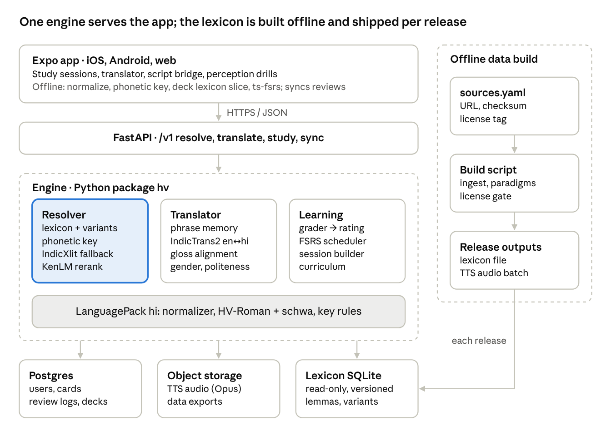

# Technical architecture

Python for the language engine and API, one TypeScript app for web and mobile, and a versioned lexicon file as the shared contract between them.

## 1. Stack decisions

Per the Oct 26 decision, each component starts with the simplest thing that works and names its upgrade, so nothing has to be redesigned to improve it.

| Component | Start with | Why | Upgrade path |
| --- | --- | --- | --- |
| Engine language | Python 3.12, packaged as `hv` | Every Indic NLP library used here is Python | Port hot paths (normalize, key, lookup) to TypeScript for offline grading |
| API | FastAPI + Pydantic v2, served by Uvicorn | Typed request/response models generate the OpenAPI spec the app consumes | Split model inference into its own service when load requires |
| Lexicon store | Read-only SQLite file built offline, versioned, loaded per worker | Fast indexed lookups, one file to ship and diff | Same schema in Postgres if editors need live curation |
| App data | Postgres 16 via Supabase (also provides auth and file storage) | One managed service covers users, cards, logs and audio | Self-hosted Postgres; keep SQL portable |
| Translation | IndicTrans2 distilled 200M, both directions, via Hugging Face transformers + IndicTransToolkit ([model card](https://huggingface.co/ai4bharat/indictrans2-en-indic-dist-200M); [toolkit](https://github.com/VarunGumma/IndicTransToolkit)) | MIT-licensed, strong Hindi quality, CPU-capable | INT8 ONNX or CTranslate2 builds ([ONNX packages](https://huggingface.co/remiai3/TRANSLATION_MODELS)); 1B model on GPU |
| Transliteration fallback | `ai4bharat-transliteration` XlitEngine, Hindi, beam 10 with rescoring ([PyPI](https://pypi.org/project/ai4bharat-transliteration/)) | Ranked Devanagari candidates for unseen words | CTranslate2 build that drops the Fairseq dependency ([HF](https://huggingface.co/Singla0009/all-indic-transliteration)) |
| Token language ID | English wordlist + lexicon membership + character n-gram classifier | No model download; handles homographs with context | IndicLID (MIT; has a hin\_Latn class) for sentence-level calls ([IndicLID](https://ai4bharat.iitm.ac.in/?p=1123)) |
| Sentence reranking | KenLM 5-gram trained on normalized Hindi Wikipedia text from Dakshina | Small, fast, well understood | Small transformer LM |
| Schwa deletion | Ohala rule + curated lists | Works day one | Arora et al. classifier |
| Script normalization | Own normalizer following section 4 of the spec | No heavy build tooling | Nisaba (Apache 2.0) via its Python bindings |
| Scheduler | py-fsrs on server; ts-fsrs on device | Same algorithm both sides | Per-learner parameter optimization |
| TTS | Indic Parler-TTS, audio pre-generated for every lexicon word and phrase, stored as Opus ([model](https://huggingface.co/ai4bharat/indic-parler-tts)) | Apache 2.0; named Hindi voices give voice variety for perception drills | Native-speaker recordings for the core 500 words |
| App | Expo (React Native) + TypeScript, one codebase for iOS, Android and web | Matches the web-and-mobile decision with one team | Native modules only if audio latency demands |
| Fonts | Noto Sans Devanagari, bundled | Consistent conjunct rendering on all platforms |  |
| Hosting | Docker image on a single managed VM or container host | Models load once at startup | Autoscaled container service; GPU node for MT |
| Observability | Sentry for errors, structured JSON logs, OpenTelemetry traces | Find slow pipeline stages | Dashboards per ambiguity class |

Memory planning estimate: a 200M-parameter model in 32-bit floats needs roughly 0.8 GB, so two directions need about 1.6 GB before INT8 quantization. Measure this in Phase 2 rather than trusting the estimate.

## 2. System diagram



The resolver is highlighted because every other part depends on it: translation, grading and the offline app all start by resolving romanized text to Devanagari. All Hindi-specific rules live in the LanguagePack band, so a second language replaces that band only.

## 3. Core interfaces

All language-specific behavior sits behind one `LanguagePack` protocol; the resolver, translator and learning code never mention Hindi. Adding a language means writing a new pack, not editing the pipeline.

```python
from dataclasses import dataclass, field
from typing import Protocol, Sequence

@dataclass(frozen=True)
class Token:
    text: str            # as typed
    norm: str            # Latin-normalized
    start: int; end: int # offsets into the original input
    lang: str            # "hi" | "en" | "num" | "punct"
    lang_conf: float

@dataclass(frozen=True)
class Candidate:
    native: str          # storage-form Devanagari
    lemma_id: int | None
    canonical: str       # HV-Roman of this surface form
    source: str          # "canonical" | "variant" | "key" | "edit" | "xlit"
    score: float

@dataclass
class Resolution:
    tokens: list[Token]
    best: list[Candidate | None]     # one per token; None = pass-through
    alternatives: list[list[Candidate]]
    confidence: list[float]

class LanguagePack(Protocol):
    code: str                         # "hi"
    mt_code: str                      # "hin_Deva" (IndicTrans2 tag)
    scheme_version: str               # "hv-roman 1.0.0"

    def normalize_native(self, s: str) -> str: ...
    def match_key_native(self, s: str) -> str: ...
    def normalize_latin(self, s: str) -> str: ...
    def phonetic_key(self, latin: str) -> str: ...
    def to_canonical(self, native_word: str) -> str: ...
    def to_precise(self, native_word: str) -> str: ...
    def edit_costs(self) -> dict[tuple[str, str], float]: ...
    def lexicon_path(self) -> str: ...
    def tts_voices(self) -> Sequence[str]: ...

class Resolver:
    def __init__(self, pack: LanguagePack, lexicon, lm, xlit, langid): ...
    def resolve(self, text: str) -> Resolution: ...

class Translator:
    def to_english(self, res: Resolution) -> "Translation": ...
    def from_english(self, text: str, *, speaker_gender: str,
                     politeness: str) -> "Translation": ...

class Grader:
    def grade(self, card, answer: str, latency_ms: int) -> "Grade": ...
```

Contract tests run against every pack: normalization is idempotent, `to_canonical` round-trips through the resolver for every lexicon entry, and `phonetic_key` maps every listed variant of a lemma to keys that include the lemma's candidates.

## 4. API specification

A versioned JSON API under `/v1`; FastAPI generates the OpenAPI document, and the app's TypeScript client is generated from it so the two cannot drift.

| Method + path | Purpose | Key fields |
| --- | --- | --- |
| POST /v1/resolve | Romanized text → Devanagari candidates per token | text, lang |
| POST /v1/translate | Either direction, with gloss and respelling notes | text, direction (rom\_to\_en, en\_to\_rom), lang, speaker\_gender, politeness |
| POST /v1/romanize | Devanagari → canonical + precise | text |
| GET /v1/lexicon/{lemma\_id} | Entry, forms, glosses, audio URLs |  |
| GET /v1/lexicon/search | Look up by English, any spelling, or Devanagari | q |
| GET /v1/study/session | Due cards + new items for today | limit\_new |
| POST /v1/study/review | Grade an answer, update FSRS, return feedback | card\_id, answer, latency\_ms, client\_review\_id |
| POST /v1/study/sync | Upload reviews done offline | reviews\[\] (idempotent by client\_review\_id) |
| POST /v1/decks/{deck\_id}/items | Save a translated sentence or word to a deck | text, native, source |
| GET /v1/progress | Known words, retention, script stage |  |
| GET /v1/me/export | Full data export |  |
| DELETE /v1/me | Account and data deletion |  |

### Example: POST /v1/translate

```json
// request
{ "text": "mera phone kharab h", "direction": "rom_to_en", "lang": "hi" }

// response
{
  "english": "My phone is broken.",
  "native": "मेरा फ़ोन ख़राब है",
  "canonical": "mera phone kharaab hai",
  "tokens": [
    { "text": "mera",   "lang": "hi", "native": "मेरा", "canonical": "mera",    "gloss": "my (m.)",   "confidence": 0.97, "respelled": false },
    { "text": "phone",  "lang": "en", "native": "फ़ोन",  "canonical": "phone",   "gloss": "phone",     "confidence": 0.99, "respelled": false },
    { "text": "kharab", "lang": "hi", "native": "ख़राब", "canonical": "kharaab", "gloss": "broken, bad", "confidence": 0.93, "respelled": true },
    { "text": "h",      "lang": "hi", "native": "है",   "canonical": "hai",     "gloss": "is",        "confidence": 0.88, "respelled": true }
  ],
  "alternatives": [],
  "engine": { "scheme": "hv-roman 1.0.0", "lexicon": "2026.11.0", "mt": "indictrans2-indic-en-dist-200M" }
}
```

Errors use RFC 9457 problem+json. Every response carries the scheme, lexicon and model versions so any reported mistake can be reproduced exactly.

## 5. Budgets, offline behavior, security and privacy

These are proposed targets for a single CPU server; Phase 2 measures them and either meets them or revises them in this table.

| Operation | p95 target | Where it runs |
| --- | --- | --- |
| Romanize a sentence (Devanagari → HV-Roman) | 5 ms | Server and device |
| Resolve a 10-word romanized sentence | 50 ms (lexicon path), 250 ms with IndicXlit fallback | Server |
| Translate a 15-word sentence | 800 ms on CPU | Server |
| Grade a study answer | 30 ms | Device (offline) and server |
| App cold start to first card | 2 s on a mid-range phone | Device |
| Lexicon download for offline use | under 15 MB compressed for A1–A2 words, variants and paradigms | Device |

### Offline behavior

- Studying works fully offline: the app holds the learner's deck slice of the lexicon, a TypeScript port of normalization, phonetic key and lookup, and ts-fsrs.
- Reviews done offline are queued with a client-generated id and synced idempotently; the server's FSRS replays them in timestamp order and is the source of truth.
- Translation and free-text resolution need the network; the UI says so instead of failing silently.

### Security and privacy

- Translation text is not stored by default; review logs store the learner's answer because grading quality depends on it, and this is stated in the privacy notice.
- Learner identifiers in analytics are pseudonymous; raw answers are excluded from analytics exports.
- Export and delete endpoints exist from the first public release.
- Rate limiting on /translate and /resolve per account and per IP, since they run the expensive models.
- If the app may be used by people under 13 (or the local age of digital consent), get legal review before launch; the default plan is an age gate.

## 6. Extending beyond Hindi

The Hindi design generalizes in two tiers: other Indic languages reuse almost every resource, while other script families reuse the architecture but need new data, new rules and often a different translation model.

### What every new LanguagePack must supply

1. A written canonical romanization spec in the format of the Linguistics tab, reviewed by a native speaker and a linguist.
2. A native-script normalizer and match key.
3. A variant source: attested romanizations (lexicon pairs) plus rule-generated alternations.
4. A word frequency list and a monolingual corpus for the language model.
5. A translation model with that language and English.
6. TTS voices, and a gold test set of romanized sentences.

### By script family

| Family | Examples | Reusable resources | Language-specific work |
| --- | --- | --- | --- |
| Other Brahmic (Indic) | Bengali, Marathi, Punjabi, Gujarati, Tamil, Telugu | Dakshina covers 12 South Asian languages ([repo](https://github.com/google-research-datasets/dakshina)); Aksharantar covers 21; IndicXlit, IndicTrans2 (22 languages), IndicLID, Indic Parler-TTS; Nisaba normalization | Schwa behaves differently (Bengali keeps medial schwas Hindi deletes); Marathi shares Devanagari, so the pack needs a language tag, not just a script |
| Perso-Arabic | Urdu, Sindhi, Kashmiri | Dakshina (Urdu, Sindhi), IndicTrans2 | Short vowels usually unwritten, so the canonical romanization needs vowel prediction from the lexicon; right-to-left UI |
| Cyrillic, Greek | Russian, Ukrainian, Greek | uroman as a baseline candidate generator ([uroman](https://pypi.org/project/uroman)) | Mostly alphabetic, so romanization is closer to letter mapping; stress is unwritten |
| Arabic, Hebrew | Arabic, Hebrew | uroman baseline | Unwritten vowels as for Urdu; Arabic chat alphabet uses digits for letters (3, 7), so the Latin normalizer must keep digits inside words |
| CJK | Mandarin, Japanese, Korean | Established standards (pinyin, Hepburn, Revised Romanization) can serve as the canonical scheme | Word segmentation; tones (Mandarin) and kanji readings need a dictionary, not character rules |

uroman's own documentation says a romanizer is not a full transliterator ([uroman](https://pypi.org/project/uroman)); use it to propose candidates and test coverage, never as the taught standard.

Translation outside IndicTrans2's 22 languages needs a separate model choice, to be made when the second family is scoped.
